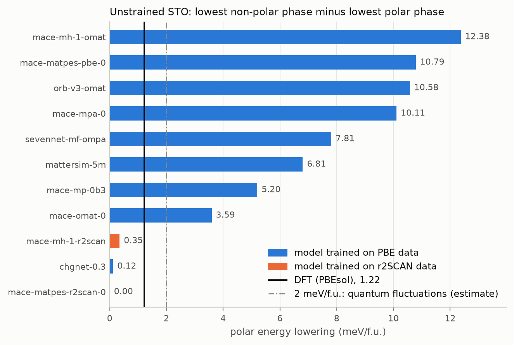
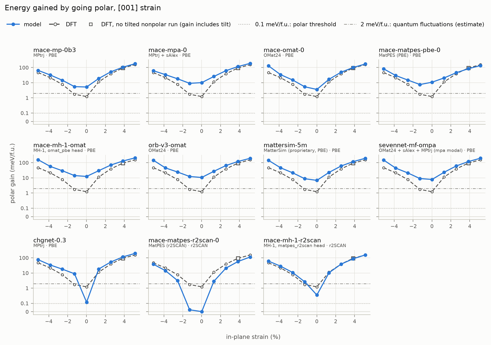
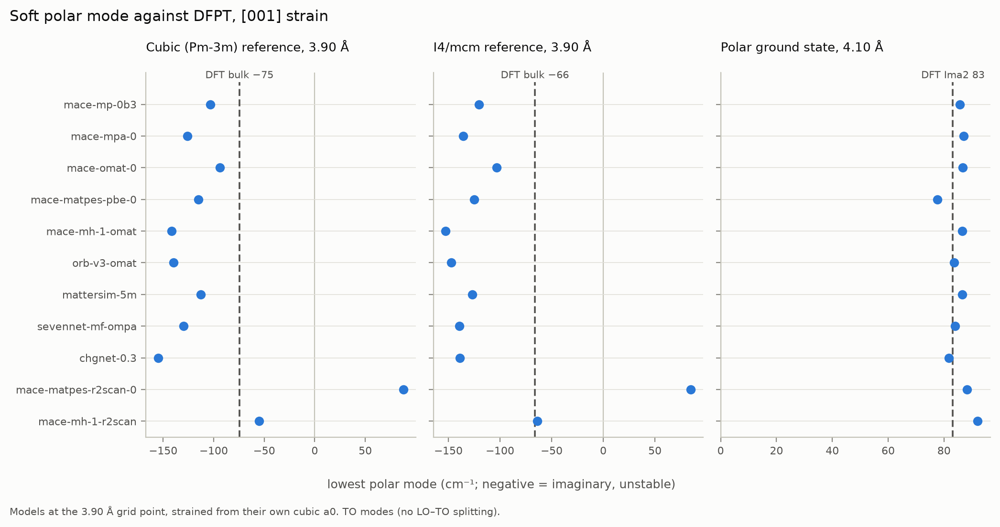

# Foundation MLIPs for strained SrTiO3: a comparison with DFT

This repository compares 11 foundation machine learned interatomic potentials (MLIPs) with DFT calculations from my
PhD, for SrTiO3 (STO) under [001] epitaxial strain. All calculations are at 0 K.

## Summary



Polar energy lowering of unstrained STO (the lowest non-polar phase minus the lowest polar phase), each model at its
own cubic lattice parameter, against DFT (black line). The dash-dot line marks 2 meV/f.u., the estimated scale of
quantum fluctuations.

1. Most of the models trained on PBE data make STO far too polar. Without strain, 8 of the 9 lower their energy by
   3.6-12.4 meV/f.u. on going polar, compared with 1.2 meV/f.u. in DFT, so they would predict unstrained STO to be
   ferroelectric.
2. The functional of the training data matters more than the architecture. The MH-1 MACE model lowers its energy by
   12.4 meV/f.u. with its PBE head, but only 0.35 meV/f.u. with its r2SCAN head.
3. Most models still find the DFT phase sequence under strain (I4cm under compression, Cc near zero strain and Ima2
   under tension), and three of them match DFT at all nine strains.
4. Two of the relaxed polar ground states were saddle points, which only the phonons revealed.

Since the DFT reference uses PBEsol, part of the excess polarisation of the PBE-trained models may come from PBE itself
(see Limitations).

## Background

STO has an extremely flat energy landscape, sitting on the verge of several polar and non-polar phases. In DFT the
unstrained ground state is polar, but only marginally (1.2 meV/f.u. below the lowest non-polar phase here), and
experimentally STO remains paraelectric down to the lowest temperatures due to quantum fluctuations, estimated at
roughly 2 meV/f.u. (Watanabe, PRB 99, 064107 (2019)). Epitaxial strain stabilises the polar phases, and strained STO
films can be ferroelectric at room temperature (Haeni et al., Nature 430, 758 (2004)). Since these energy differences
are only a few meV/f.u., with octahedral tilting competing with the polar mode, strained STO makes a good test of how
well MLIPs trained across the periodic table capture the finer features of an energy landscape.

## Method

The DFT reference is a set of VASP (PBEsol) relaxations at nine in-plane lattice parameters from 3.70 to 4.10 Å
(-5.1 to +5.1% strain), along with DFPT phonons for eight structures. For each model and strain, we relax the
non-polar (Pm-3m, I4/mcm, Imma and C2/c) and polar phases of a 20-atom √2×√2×2 cell with the in-plane lattice vectors
held fixed, and compare the energy lowering of the polar phase, the Ti off-centring, the octahedral tilts and the space
group with DFT. Strain is measured from each model's own cubic lattice parameter. We then calculate Γ-point phonons of
the non-polar phases and of each polar ground state, and compare the soft polar modes with DFPT.

Nine of the models are trained on PBE data and two on r2SCAN. The calculations use ASE, phonopy and spglib, with each
model run through its own package.

## Results

### 1. Do the models reproduce the polar instability of STO?

We find that most of the PBE-trained models make STO far too polar. Without strain, 8 of the 9 lower their energy by
3.6-12.4 meV/f.u. on going polar, compared with 1.2 meV/f.u. in DFT, and displace Ti by 0.12-0.18 Å rather than
0.08 Å. In DFT the polar energy lowering first exceeds 2 meV/f.u. somewhere between 1.3 and 2.6% compressive strain,
and between 0 and 1.3% tensile strain, whereas in these eight models it exceeds this at every strain, so they would
predict unstrained STO to be ferroelectric. The cubic soft polar mode is also too unstable in all nine (-94 to
-155 cm-1, compared with -75 cm-1 from DFPT).

### 2. Does the functional of the training data matter?

We find that it matters more than the architecture. The MH-1 MACE model lowers its energy by 12.4 meV/f.u. with its
PBE output head, but only 0.35 meV/f.u. with its r2SCAN head, and the two MatPES models, trained on the same
structures, give 10.8 (PBE) and 0.00 meV/f.u. (r2SCAN). MH-1 with the r2SCAN head is the closest model to DFT overall,
matching the DFT phase at all nine strains. MATPES-r2SCAN, however, goes too far the other way, with no polar
instability in cubic STO at all (its soft mode is stable, at +88 cm-1).

### 3. Do the models find the right phases?

Most models reproduce the DFT phase sequence, with I4cm in the compressive regime, Cc near zero strain and Ima2 in the
tensile regime, and three of them (MP-0b3, MPA-0 and MH-1 r2SCAN) match DFT at every strain. The main exception is the
largest compressive strain, where six of the PBE-trained models choose an untilted P4mm phase, which in DFT lies
27 meV/f.u. above the I4cm ground state.

### 4. Are the relaxed ground states true minima?

Not in every case. Two of the polar ground states found by relaxation (CHGNet at -1.3% and MH-1 r2SCAN at zero
strain) turned out to be saddle points, which only showed up in the phonons. Following the unstable mode moves MH-1
r2SCAN into the Cc phase found in DFT.

| Model | Trained on | Polar energy lowering, unstrained (meV/f.u.) | Phases matching DFT (of 9) | Cubic soft mode (cm-1) |
|---|---|---|---|---|
| DFT (PBEsol) | | 1.22 | | -75 |
| mace-mp-0b3 | PBE | 5.20 | 9 | -103 |
| mace-mpa-0 | PBE | 10.11 | 9 | -126 |
| mace-omat-0 | PBE | 3.59 | 8 | -94 |
| mace-matpes-pbe-0 | PBE | 10.79 | 6 | -115 |
| mace-mh-1-omat | PBE | 12.38 | 8 | -142 |
| orb-v3-omat | PBE | 10.58 | 7 | -140 |
| mattersim-5m | PBE | 6.81 | 8 | -113 |
| sevennet-mf-ompa | PBE | 7.81 | 8 | -130 |
| chgnet-0.3 | PBE | 0.12 | 8 | -155 |
| mace-matpes-r2scan-0 | r2SCAN | 0.00 | 7 | +88 |
| mace-mh-1-r2scan | r2SCAN | 0.35 | 9 | -55 |

The polar energy lowering is the energy of the lowest non-polar phase minus that of the lowest polar phase. The cubic
soft mode is the lowest polar phonon of cubic STO at the model's own lattice parameter (from DFPT for DFT), where
negative values are imaginary (unstable).



Figure 1: Polar energy lowering against strain for each model (blue) and DFT (grey). The dotted and dash-dot lines
mark 0.1 meV/f.u. (the numerical threshold) and 2 meV/f.u. (the estimated scale of quantum fluctuations).


Figure 2: Ground state phase at each strain.



Figure 3: Lowest polar mode of cubic and I4/mcm STO near zero strain, and of the polar ground state at +5.1%,
compared with DFPT.

The Ti off-centring and tilt against strain are shown in [fig2](figures/fig2_displacement_001.png) and
[fig3](figures/fig3_tilt_001.png), and the tables behind the figures are in `results/`.

## Limitations

The DFT reference uses PBEsol, while the models are trained on PBE or r2SCAN data, so part of the excess polarisation
of the PBE-trained models may come from PBE itself rather than from the models, which this comparison cannot separate.
All calculations are at 0 K, with quantum fluctuations only included through the rough 2 meV/f.u. estimate, and only
[001] strain is considered, at nine strains 1.3% apart in a 20-atom cell.

## Details

- The in-plane lattice vectors are held fixed while the out-of-plane vector relaxes freely
  (`sto.structures.EpitaxialCellFilter`).
- Non-polar phases are relaxed with their symmetry held (ASE `FixSymmetry`), and polar phases without symmetry,
  starting from three small Ti displacements. Forces are converged below 2 meV/Å.
- A structure is counted as polar if its energy lowering exceeds 0.1 meV/f.u. and Ti moves by more than 0.005 Å.
  Space groups are found with spglib at 0.005 Å, and polar runs within 0.1 meV/f.u. of each other are treated as the
  same state.
- Phonons are calculated by finite differences (phonopy, 0.01 Å) at Γ of the 20-atom cell. Modes are labelled polar
  or tilt using the STO Born effective charges (Zhong, King-Smith and Vanderbilt, PRL 72, 3618 (1994)) and rigid
  rotations of the octahedra. Polar ground states with an unstable mode are displaced along it and relaxed again to
  0.2 meV/Å.

## Models

| Name | Training data | Functional* | Package |
|---|---|---|---|
| mace-mp-0b3 | MPtrj | PBE | mace-torch |
| mace-mpa-0 | MPtrj + sAlex | PBE | mace-torch |
| mace-omat-0 | OMat24 | PBE | mace-torch |
| mace-matpes-pbe-0 | MatPES | PBE | mace-torch |
| mace-matpes-r2scan-0 | MatPES | r2SCAN | mace-torch |
| mace-mh-1-omat | MH-1, `omat_pbe` head | PBE | mace-torch |
| mace-mh-1-r2scan | MH-1, `matpes_r2scan` head | r2SCAN | mace-torch |
| orb-v3-omat | OMat24 (conservative, unlimited neighbours) | PBE | orb-models |
| mattersim-5m | MatterSim | PBE | mattersim |
| sevennet-mf-ompa | OMat24 + sAlex + MPtrj (`mpa` modal) | PBE | sevenn |
| chgnet-0.3 | MPtrj | PBE | chgnet |

*Materials Project and OMat24 apply +U to some transition metals but not to Ti, so every PBE+U model here is
effectively trained on plain PBE for STO. The model weights have their own licences, and the MACE OMAT, MatPES and
MH-1 weights are for non-commercial use only.

## Data and code

- `data/`: every ionic step of the 79 VASP runs used (1824 frames, with energies, forces and stresses), and the final
  structure of each run. The raw VASP files are not included.
- `results/`: all model relaxations and phonon calculations, along with the summary tables behind the figures.
- `sto/` holds the analysis code, `scripts/` the individual steps and `tests/` the unit tests.

To run the calculations again (the DFT space groups in Figure 2 are read from the raw VASP runs):

```bash
bash setup_mac.sh                                          # environments and model weights (~20 GB)
./run.sh scripts/04_strain_relax.py --orientations 001     # relaxations (~2.5 h on an M-series Mac)
./run.sh scripts/05_phonons.py --orientations 001          # phonons (~30 min)
~/.sto-envs/mace/bin/python scripts/06_figures.py          # figures and tables
~/.sto-envs/mace/bin/python -m pytest tests                # tests
```

## Licence

The code is under the MIT licence, and the DFT data and results under CC BY 4.0.

## Author

Alexander Lione ([decipherphysics.com](https://www.decipherphysics.com)). The DFT calculations are from my
[PhD thesis](https://etheses.durham.ac.uk/id/eprint/16104/) (Durham University, 2025). Claude (Anthropic) was used in
preparing this work, to write the code and the text.
