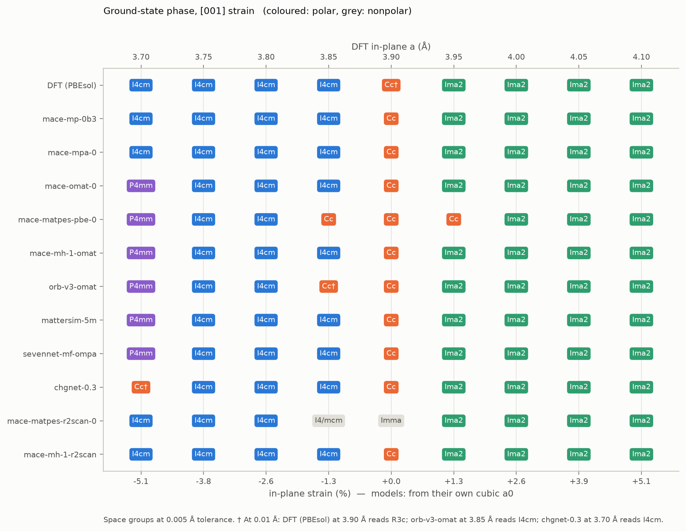
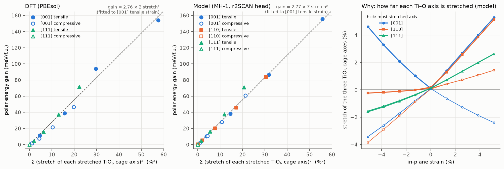

# Foundation MLIPs for strained SrTiO3: a comparison with DFT

This repository compares 11 foundation machine learned interatomic potentials (MLIPs) with DFT calculations from my
PhD, for SrTiO3 (STO) under [001] epitaxial strain. The model closest to DFT (MACE MH-1 with its r2SCAN head) is then
used for films grown along [111], again compared with DFT, and along [110], where there is no DFT to compare with, so
those results are a prediction. All calculations are at 0 K.

## Summary


Polar energy lowering of unstrained STO (the lowest non-polar phase minus the lowest polar phase), each model at its
own cubic lattice parameter, against PBEsol DFT (black line). The dash-dot line marks 2 meV/f.u., a rough estimate of
the scale of quantum fluctuations, not a threshold for ferroelectricity (see Background).

1. Most of the models trained on PBE data make STO much more polar than PBEsol DFT does. Without strain, 8 of the 9
   lower their energy by 3.6-12.4 meV/f.u. on going polar, compared with 1.2 meV/f.u. in DFT. This is a comparison
   with PBEsol, not with experiment, and PBEsol is not exact for this instability (see Background).
2. The functional of the training data matters more than the architecture. The MH-1 MACE model lowers its energy by
   12.4 meV/f.u. with its PBE head, but only 0.35 meV/f.u. with its r2SCAN head.
3. Most models still find the DFT phase sequence under strain (I4cm under compression, Cc near zero strain and Ima2
   under tension), and three of them match DFT at all nine strains.
4. Two of the relaxed polar ground states were saddle points, which only the phonons revealed.

Since the DFT reference uses PBEsol, part of the difference between the PBE-trained models and DFT may come from PBE
itself (see Limitations).

For films grown along other directions, using the best model:

5. The best model also works for [111] strain. It finds the same kind of structure as DFT at all nine strains. Under
   tensile strain the film becomes polar, with an energy lowering within 4% of DFT. Under compressive strain neither
   the model nor DFT becomes polar, and the oxygen octahedra only tilt. This matches an earlier DFT study of [111]
   strained STO. The model's tilts are 1.0-1.4° smaller than in PBEsol DFT, most likely because PBEsol overestimates
   these tilts (see Background).
6. For [110] strain, where there is no DFT, the model predicts that the film does not become polar under compressive
   strain (apart from a very weak polarisation at the largest strain), and becomes polar within the film plane under
   tensile strain, with about half the energy lowering of a [001] film.
7. The orientation matters because of how the strain changes the Ti-O bonds. Whatever the orientation, the energy
   lowering on going polar grows roughly with the square of how far the strain lengthens the Ti-O bonds. Compressive
   [110] and [111] strain shortens every Ti-O bond, so these films stay non-polar, whereas compressive [001] strain
   lengthens the bonds along the growth direction, so [001] films become polar.

## Background

STO has an extremely flat energy landscape, sitting on the verge of several polar and non-polar phases. In PBEsol DFT
the unstrained ground state is polar, but only marginally (1.2 meV/f.u. below the lowest non-polar phase here), while
experimentally STO remains paraelectric down to the lowest temperatures because of quantum fluctuations of the ions.
Their scale has been estimated at roughly 2 meV/f.u. (Watanabe, PRB 99, 064107 (2019)), but this is a rough guide, not
a threshold: whether a polar well survives them depends on its shape as well as its depth. A study using the random
phase approximation (RPA), which describes this instability better than PBEsol, finds a polar energy barrier of almost
7 meV/f.u., against less than 0.5 meV/f.u. with PBEsol along the same modes, and still finds STO paraelectric once the
quantum motion of the ions is included (Verdi et al., Phys. Rev. Materials 7, L030801 (2023)). PBEsol also
overestimates the octahedral tilt of unstrained STO, at 5.64° against 2.1° measured at 4.2 K, where SCAN gives 2.4°
and HSE06 2.5° (Begum, Gruner and Pentcheva, Phys. Rev. Materials 3, 065004 (2019)). Epitaxial strain stabilises the
polar phases, and strained STO films can be ferroelectric at room temperature (Haeni et al., Nature 430, 758 (2004)).
Since these energy differences are only a few meV/f.u., with octahedral tilting competing with the polar mode, strained
STO makes a good test of how well MLIPs trained across the periodic table capture the finer features of an energy
landscape.

## Method

The DFT reference is a set of VASP (PBEsol) relaxations at nine in-plane lattice parameters from 3.70 to 4.10 Å
(-5.1 to +5.1% strain), along with DFPT phonons for eight structures. For each model and strain, we relax the
non-polar (Pm-3m, I4/mcm, Imma and C2/c) and polar phases of a 20-atom √2×√2×2 cell with the in-plane lattice vectors
held fixed, and compare the energy lowering of the polar phase, the Ti off-centring, the octahedral tilts and the space
group with DFT. Strain is measured from each model's own cubic lattice parameter. We then calculate Γ-point phonons of
the non-polar phases and of each polar ground state, and compare the soft polar modes with DFPT.

Nine of the models are trained on PBE data and two on r2SCAN. The calculations use ASE, phonopy and spglib, with each
model run through its own package.

## Results

### 1. Do the models reproduce the polar instability of STO?

We find that most of the PBE-trained models make STO much more polar than PBEsol DFT does. Without strain, 8 of the 9
lower their energy by 3.6-12.4 meV/f.u. on going polar, compared with 1.2 meV/f.u. in DFT, and displace Ti by
0.12-0.18 Å rather than 0.08 Å. In DFT the polar energy lowering first exceeds 2 meV/f.u. somewhere between 1.3 and
2.6% compressive strain, and between 0 and 1.3% tensile strain, whereas in these eight models it exceeds this at every
strain. The cubic soft polar mode is also more unstable in all nine (-94 to -155 cm-1, compared with -75 cm-1 from
DFPT). This comparison cannot say whether they are wrong about real STO: the 2 meV/f.u. line is only a rough scale, and
the RPA gives a deeper polar well than PBEsol does (see Background).

### 2. Does the functional of the training data matter?

We find that it matters more than the architecture. The MH-1 MACE model lowers its energy by 12.4 meV/f.u. with its
PBE output head, but only 0.35 meV/f.u. with its r2SCAN head, and the two MatPES models, trained on the same
structures, give 10.8 (PBE) and 0.00 meV/f.u. (r2SCAN). MH-1 with the r2SCAN head is the closest model to DFT overall,
matching the DFT phase at all nine strains. MATPES-r2SCAN, however, goes too far the other way, with no polar
instability in cubic STO at all (its soft mode is stable, at +88 cm-1).

### 3. Do the models find the right phases?

Most models reproduce the DFT phase sequence, with I4cm in the compressive regime, Cc near zero strain and Ima2 in the
tensile regime, and three of them (MP-0b3, MPA-0 and MH-1 r2SCAN) match DFT at every strain. The main exception is the
largest compressive strain, where six of the PBE-trained models choose an untilted P4mm phase, which in DFT lies
27 meV/f.u. above the I4cm ground state.

### 4. Are the relaxed ground states true minima?

Not in every case. Two of the polar ground states found by relaxation (CHGNet at -1.3% and MH-1 r2SCAN at zero
strain) turned out to be saddle points, which only showed up in the phonons. Following the unstable mode moves MH-1
r2SCAN into the Cc phase found in DFT.

| Model | Trained on | Polar energy lowering, unstrained (meV/f.u.) | Phases matching DFT (of 9) | Cubic soft mode (cm-1) |
|---|---|---|---|---|
| DFT (PBEsol) | | 1.22 | | -75 |
| mace-mp-0b3 | PBE | 5.20 | 9 | -103 |
| mace-mpa-0 | PBE | 10.11 | 9 | -126 |
| mace-omat-0 | PBE | 3.59 | 8 | -94 |
| mace-matpes-pbe-0 | PBE | 10.79 | 6 | -115 |
| mace-mh-1-omat | PBE | 12.38 | 8 | -142 |
| orb-v3-omat | PBE | 10.58 | 7 | -140 |
| mattersim-5m | PBE | 6.81 | 8 | -113 |
| sevennet-mf-ompa | PBE | 7.81 | 8 | -130 |
| chgnet-0.3 | PBE | 0.12 | 8 | -155 |
| mace-matpes-r2scan-0 | r2SCAN | 0.00 | 7 | +88 |
| mace-mh-1-r2scan | r2SCAN | 0.35 | 9 | -55 |

The polar energy lowering is the energy of the lowest non-polar phase minus that of the lowest polar phase. The cubic
soft mode is the lowest polar phonon of cubic STO at the model's own lattice parameter (from DFPT for DFT), where
negative values are imaginary (unstable).


Figure 1: Polar energy lowering against strain for each model (blue) and DFT (grey). The dotted and dash-dot lines
mark 0.1 meV/f.u. (the numerical threshold) and 2 meV/f.u. (a rough estimate of the scale of quantum fluctuations).



Figure 2: Ground state phase at each strain.


Figure 3: Lowest polar mode of cubic and I4/mcm STO near zero strain, and of the polar ground state at +5.1%,
compared with DFPT.

The Ti off-centring and tilt against strain are shown in [fig2](figures/fig2_displacement_001.png) and
[fig3](figures/fig3_tilt_001.png), and the tables behind the figures are in `results/`.

## Other strain orientations

We then use the model closest to DFT, MH-1 with its r2SCAN head, for films grown along [111] and [110], at the same
nine strains, again measured from the model's own cubic lattice parameter. At each strain we relax non-polar
structures with the octahedra untilted or tilted about each distinct high-symmetry axis, start polar relaxations from
the two lowest, and check the lowest state with Γ-point phonons. For [111] we compare with the [111] DFT relaxations
from my PhD (PBEsol, 30- and 60-atom cells, several starting structures at each strain), and also relax each final DFT
structure with the model. For [110] there is no DFT, so these results are a prediction.

### 5. Does the best model also work for [111] strain?

Yes. We find the same kind of structure as DFT at all nine strains (Figure 4). In the compressive regime both are
non-polar, with the oxygen octahedra tilted about an axis in the film plane. The model tilts them about [1-10] (C2/m)
and DFT about [11-2] (C2/c), but in the model these two lie within 0.4 meV/f.u. of each other, and no DFT run started
from the model's axis, so this difference is not settled. Without strain both find the weakly polar R3c phase
(0.33 meV/f.u. below the lowest non-polar phase, against 0.58 meV/f.u. in DFT). In the tensile regime both find the
polar Cc phase, with Ti moving mostly within the film plane. The energy lowering is within 4% of DFT at every tensile
strain (71.1 against 71.5 meV/f.u. at +5.1%) and the Ti off-centring within 0.007 Å. As for [001], the model's tilts
are smaller than in DFT, by 1.0-1.4° in the compressive regime. Since PBEsol overestimates the tilts of STO by more
than a factor of two (see Background) and the model is trained on r2SCAN data, this difference most likely comes from
the functional rather than from the model. None of the model's ground states is a saddle point.

These results agree with an earlier DFT study (Reyes-Lillo, Rabe and Neaton, Phys. Rev. Materials 3, 030601 (2019)),
which also finds [111] strained STO non-polar under compressive strain and polar, in the Cc phase, under larger
tensile strain.

### 6. What does the model predict for [110] strain?

In the compressive regime the film is non-polar (Figure 5), with the octahedra tilted about the in-plane [1-10] axis
(Imma, 4.9-8.4°), apart from a very weak polarisation along the film normal at the largest strain (Imm2, 0.38 meV/f.u.
at -5.1%). In the tensile regime it becomes polar (Cc), with Ti moving within the film plane at about 40° to [001],
and an energy lowering about half that of a [001] film at the same strain (84 against 156 meV/f.u. at +5.1%). From the
[001] and [111] comparisons, we expect the kind of structure to be right, the energy lowering under tensile strain to
be within about 10% of PBEsol and the tilts up to about 2° smaller than PBEsol would give. Since the model's energy
lowering under compressive [001] strain is 30-51% above PBEsol's, the weak polarisation at -5.1% may well be absent in
PBEsol DFT.

The only DFT study of [110] strained STO we found (Angsten, Martin and Asta, Phys. Rev. B 95, 174110 (2017)) uses
five-atom cells, which leave out the octahedral tilts. It also finds polarisation within the film plane under tensile
strain, but under compressive strain it finds polarisation along the film normal, where we find tilts instead. Since
the tilts compete with the polarisation, a DFT calculation that includes them is needed to settle this.

### 7. Why does the orientation matter?

Strain changes the lengths of the Ti-O bonds, and Ti moves off centre more easily along a direction in which its bonds
are longer than in cubic STO. We find that, across all three orientations, the polar energy lowering is close to k
times the sum of the squares of these lengthenings (the stretch of each TiO6 cage axis that is longer than in cubic
STO, in %), with k = 2.76 meV/f.u. per %² for DFT and 2.77 for the model, fitted to the [001] films under tensile
strain only (Figure 6). Compressive [110] and [111] strain shortens every Ti-O bond, so these films stay non-polar,
while compressive [001] strain lengthens the bonds along the growth direction, so [001] films become polar. Under
tensile [111] strain each bond lengthens by only about half the strain of the film, so the energy lowering is less
than half that of [001] (38-47%). For [111] the energy lowering lies between 22% below and 25% above the rule, and for
[110] within 5% of it. In the compressive [001] regime, however, DFT lies 15-44% below the rule while the model
follows it to within 11%, which is the likely reason the model's energy lowering is higher there: in DFT the larger
octahedral tilts compete with the polarisation. Since PBEsol overestimates these tilts, the competition in real STO
may be weaker than in DFT.

![Phases of [111] strained STO, model against DFT](figures/fig_phases_111.png)

Figure 4: [111] strain. Ground state phase, polar energy lowering, Ti off-centring and octahedral tilt against strain,
for the model (solid) and DFT (dashed, open symbols). The off-centring and tilt are split into their parts in the film
plane and along the film normal.

![Phases of [110] strained STO predicted by the model](figures/fig_phases_110.png)

Figure 5: [110] strain, model only. Ground state phase, polar energy lowering, Ti off-centring and octahedral tilt
against strain, along the three film axes, with the same model's [001] results for comparison.



Figure 6: Polar energy lowering against the sum of the squared stretches of the TiO6 cage axes that are longer than in
cubic STO, for DFT (left) and the model (middle), with the rule fitted to the [001] films under tensile strain (dashed
line). Filled symbols are tensile strain and open symbols compressive. Right: the stretch of the three cage axes
against strain in the model, for each orientation.

## Limitations

The DFT reference uses PBEsol, while the models are trained on PBE or r2SCAN data, so part of the difference between
the PBE-trained models and DFT may come from PBE itself rather than from the models, which this comparison cannot
separate. PBEsol is not exact for STO either: it overestimates the octahedral tilt by more than a factor of two, and
the RPA gives a much deeper polar well (see Background). The comparison therefore measures agreement with PBEsol, not
with experiment, and where the r2SCAN-trained models tilt the octahedra less than DFT, they may well be closer to
experiment. All calculations are at 0 K, with quantum fluctuations only included through the rough 2 meV/f.u.
estimate, which is not a threshold for ferroelectricity, and the [001] comparison uses nine strains 1.3% apart in a
20-atom cell. The [111] and [110] calculations use only the best
model, and the [110] results have no DFT check. Under compressive [111] strain no DFT run tried the model's tilt axis,
so which axis DFT prefers is not known.

## Details

- The in-plane lattice vectors are held fixed while the out-of-plane vector relaxes freely
  (`sto.structures.EpitaxialCellFilter`).
- Non-polar phases are relaxed with their symmetry held (ASE `FixSymmetry`), and polar phases without symmetry,
  starting from three small Ti displacements. Forces are converged below 2 meV/Å.
- A structure is counted as polar if its energy lowering exceeds 0.1 meV/f.u. and Ti moves by more than 0.005 Å.
  Space groups are found with spglib at 0.005 Å, and polar runs within 0.1 meV/f.u. of each other are treated as the
  same state.
- Phonons are calculated by finite differences (phonopy, 0.01 Å) at Γ of the 20-atom cell. Modes are labelled polar
  or tilt using the STO Born effective charges (Zhong, King-Smith and Vanderbilt, PRL 72, 3618 (1994)) and rigid
  rotations of the octahedra. Polar ground states with an unstable mode are displaced along it and relaxed again to
  0.2 meV/Å.
- For [111] and [110] strain the cells hold 30 atoms ([1-10] × [01-1] × 2[111], hexagonal) and 20 atoms
  (2[001] × [1-10] × [110]). The non-polar references (seven for [111], eight for [110]) are relaxed with their
  symmetry held, and polar relaxations start from the two lowest, with every Ti moved 0.04 Å along six directions.
  The [111] structures of the model and of DFT are measured in the same way, from the structures themselves
  (`orientations/111/film_measure.py`), since the DFT cells differ from the model's.
- The orientation rule uses the three O-O distances across each TiO6 cage, measured in the lowest centrosymmetric
  state at each strain, as stretches from that method's own cubic lattice parameter.

## Models

| Name | Training data | Functional* | Package |
|---|---|---|---|
| mace-mp-0b3 | MPtrj | PBE | mace-torch |
| mace-mpa-0 | MPtrj + sAlex | PBE | mace-torch |
| mace-omat-0 | OMat24 | PBE | mace-torch |
| mace-matpes-pbe-0 | MatPES | PBE | mace-torch |
| mace-matpes-r2scan-0 | MatPES | r2SCAN | mace-torch |
| mace-mh-1-omat | MH-1, `omat_pbe` head | PBE | mace-torch |
| mace-mh-1-r2scan | MH-1, `matpes_r2scan` head | r2SCAN | mace-torch |
| orb-v3-omat | OMat24 (conservative, unlimited neighbours) | PBE | orb-models |
| mattersim-5m | MatterSim | PBE | mattersim |
| sevennet-mf-ompa | OMat24 + sAlex + MPtrj (`mpa` modal) | PBE | sevenn |
| chgnet-0.3 | MPtrj | PBE | chgnet |

*Materials Project and OMat24 apply +U to some transition metals but not to Ti, so every PBE+U model here is
effectively trained on plain PBE for STO. The model weights have their own licences, and the MACE OMAT, MatPES and
MH-1 weights are for non-commercial use only.

## Data and code

- `data/`: every ionic step of the 79 VASP runs used (1824 frames, with energies, forces and stresses), and the final
  structure of each run. The raw VASP files are not included.
- `results/`: all model relaxations and phonon calculations, along with the summary tables behind the figures.
- `orientations/`: the [111] (`111/`) and [110] (`110/`) calculations with the best model and the orientation rule
  (`rule/`), each with its scripts, tests, results and tables (`results_111.md`, `results_110.md`, `rule_table.csv`).
  `orientations/111/dft/` holds the final structures and energies of the 77 [111] VASP runs. The raw VASP files are
  not included.
- `sto/` holds the analysis code, `scripts/` the individual steps and `tests/` the unit tests.

To run the calculations again (the DFT space groups in Figure 2 are read from the raw VASP runs):

```bash
bash setup_mac.sh                                          # environments and model weights (~20 GB)
./run.sh scripts/04_strain_relax.py --orientations 001     # relaxations (~2.5 h on an M-series Mac)
./run.sh scripts/05_phonons.py --orientations 001          # phonons (~30 min)
~/.sto-envs/mace/bin/python scripts/06_figures.py          # figures and tables
~/.sto-envs/mace/bin/python -m pytest tests orientations   # tests
```

The [111] and [110] calculations and the orientation rule use the `mace` environment only:

```bash
~/.sto-envs/mace/bin/python orientations/111/scan_111.py              # [111] relaxations (~50 min)
~/.sto-envs/mace/bin/python orientations/111/dft_seeds_111.py         # DFT structures relaxed with the model (~2 h)
~/.sto-envs/mace/bin/python orientations/111/phonons_111.py           # phonon check (~3 min)
~/.sto-envs/mace/bin/python orientations/111/analyse_111.py           # table and Figure 4
~/.sto-envs/mace/bin/python orientations/110/scan_110.py              # [110] relaxations (~1 h)
~/.sto-envs/mace/bin/python orientations/110/phonons_110.py           # phonon check (~3 min)
~/.sto-envs/mace/bin/python orientations/110/analyse_110.py           # table and Figure 5
~/.sto-envs/mace/bin/python orientations/rule/orientation_rule.py     # orientation rule table
~/.sto-envs/mace/bin/python orientations/rule/orientation_rule.py fig # Figure 6
```

## Versions

- 1.2 (17 November 2026): corrected three statements that went further than a comparison with PBEsol can. The
  PBE-trained models are now described as more polar than PBEsol DFT rather than as too polar, the 2 meV/f.u. line is
  no longer read as a threshold for ferroelectricity, and the best model's smaller tilts are put down, most likely, to
  PBEsol rather than to the model. The Background and Limitations now give the known errors of PBEsol for STO. No
  calculation, figure or table changed.
- 1.1 (12 November 2026): [111] strain against DFT, [110] strain (a prediction) and the orientation rule.
- 1.0 (4 November 2026): the [001] comparison of 11 foundation MLIPs with PBEsol DFT.

## Licence

The code is under the MIT licence, and the DFT data and results under CC BY 4.0.

## Author

Alexander Lione ([decipherphysics.com](https://www.decipherphysics.com)). The DFT calculations are from my
[PhD thesis](https://etheses.durham.ac.uk/id/eprint/16104/) (Durham University, 2025). Claude (Anthropic) was used in
preparing this work, to write the code and the text.
